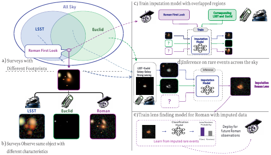
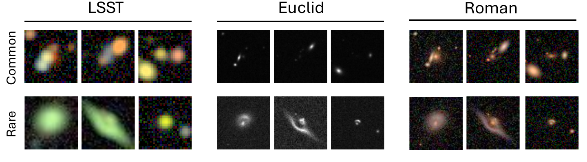

<h1 align="center">COSMIO: A Benchmark for<br>Cross-Survey Modality Imputation</h1>

<p align="center">
  
  
  
  
</p>

<p align="center"><strong>Official repository for the NeurIPS 2026 paper.</strong></p>

<p align="center"><strong>COSMIO studies how to reconstruct a missing astronomical survey observation from the surveys that are available, and whether those reconstructions remain useful for rare-event science.</strong></p>

<p align="center">
  <a href="https://www.kaggle.com/datasets/cosmidata/cosmio">Full dataset</a> ·
  <a href="https://kaggle.com/datasets/e008bbba31a8658c308ae305ec93297017c00747454138005c9b8ae2acb5e7c1">Sample dataset</a> ·
  <a href="./docs/index.html">Project page</a>
</p>



COSMIO aligns LSST, Euclid, and Roman observations, trains an imputation model on overlapped regions, evaluates transfer to rare events, and measures downstream Roman lens classification.

## TL;DR

Large sky surveys differ in wavelength coverage, resolution, noise, and footprint. Their partial overlap leaves many objects without observations in one or more surveys. COSMIO formalizes this setting as **cross-survey modality imputation** and provides aligned, forward-rendered observations for **115,000 regular galaxies** and **14,825 galaxy-galaxy strong lenses**.

This official release contains the COSMIO data protocol, **AsynDiff as the only distributed imputation implementation**, and the complete downstream Roman strong-lens classification pipeline.

## Highlights

- **Cross-survey benchmark:** aligned LSST, Euclid, and Roman views with realistic survey-specific rendering.
- **Regular-to-rare evaluation:** train on common galaxies and evaluate distribution shift on strong-lensing systems.
- **Downstream science:** test whether imputed Roman observations support strong-lens classification.
- **Focused source release:** reproducible COSMIO readers, AsynDiff training and inference, metrics, manifests, and classifier code.

## Contents

- [The benchmark](#the-benchmark)
- [Data](#data)
- [Installation](#installation)
- [AsynDiff: train and sample](#asyndiff-train-and-sample)
- [Evaluation](#evaluation)
- [Downstream Roman classification](#downstream-roman-classification)
- [Repository layout](#repository-layout)
- [Citation](#citation)

## The benchmark

Given observations of an astrophysical source in one or more surveys, the task is to infer how the same source would appear in a missing target survey. COSMIO evaluates both reconstruction quality and scientific utility.

| Track | Training / inputs | Evaluation |
| --- | --- | --- |
| Cross-survey imputation | Regular galaxies with aligned survey views | RMSE, PSNR, and CRPS on missing modalities |
| Rare-event generalization | Model trained on regular galaxies | Strong-lensing systems without rare-event retraining |
| Downstream classification | Real or AsynDiff-imputed Roman observations | Roman lens vs. non-lens classification |

## Data

The benchmark uses aligned objects rendered under three survey configurations. Readers preserve native channels, shared identifiers, deterministic splits, and normalization metadata.



| Survey | Channels | Native size | Role |
| --- | ---: | ---: | --- |
| LSST | 5 | 32 × 32 | Ground-based source modality |
| Euclid | 1 | 64 × 64 | Space-based source modality |
| Roman | 3 | 59 × 59 | Target and downstream modality |

Download the COSMIO benchmark datasets from the project-provided Kaggle links:

- [Full COSMIO dataset](https://www.kaggle.com/datasets/cosmidata/cosmio)
- [Small sample dataset](https://kaggle.com/datasets/e008bbba31a8658c308ae305ec93297017c00747454138005c9b8ae2acb5e7c1)

The reviewer sample contains 500 regular galaxies and 500 lenses from `run_000`.
For an AsynDiff sample-data check, copy `asyn-diffusion/configs/train.yaml` to a
separate config, set `data.data_root` to the extracted nonlens root,
`selected_runs: [run_000]`, `train_count: 400`, `val_count: 100` and `test_count: 0`.
Use that config for each build/train/sample command. Give its `index_path`,
`stats_path`, `visualization_subset_path` and `experiment.output_root` separate
paths so that it does not overwrite full-dataset artifacts. These sample settings
are for checking the pipeline, not reproducing the paper's training protocol.

Expected layout:

```text
data/
├── regular/
│   ├── run_000/shards/manifest_lre_nonlens.json
│   └── normalization_metadata.json
└── lens/
    ├── run_000/shards/manifest_lens.json
    └── normalization_metadata.json
```

Modalities are ordered as `(lsst, euclid, roman)`. See [the data schema](docs/data_schema.md) for manifest fields and Zarr groups.

## Installation

Python 3.10 or newer is required.

```bash
git clone https://github.com/fw-ic/COSMIO.git
cd COSMIO

python -m venv .venv
source .venv/bin/activate  # Windows: .venv\Scripts\activate
python -m pip install -r requirements.txt
python -m pip install -e asyn-diffusion
python -m pip install -e vit-lens-classification
```

For the tested Python 3.10 / Linux dependency set, use
`constraints-py310-linux.txt`. A clean CPU validation environment can be installed
and checked with:

```bash
python -m pip install --upgrade pip
python -m pip install --no-deps torch==2.4.1 torchvision==0.19.1 --index-url https://download.pytorch.org/whl/cpu
python -m pip install -c constraints-py310-linux.txt -r requirements.txt pytest
python -m pip install -e asyn-diffusion -e vit-lens-classification
python -m pip check
python -m pytest tests asyn-diffusion/tests -q
python -m pytest vit-lens-classification/tests -q
```

Run the classifier tests separately because the projects use same-named `tests`
packages. The constraints describe a validated release environment, not the
historical environment used to produce every paper result.

## AsynDiff: train and sample

The released imputation model supports asynchronous masking over LSST, Euclid, and Roman. The default protocol trains on regular-galaxy `run_000` through `run_006`; `run_007` is reserved for downstream protocols.

The released config uses a single shared output head. Its default training
schedule covers `lsst,euclid`, `lsst` and `euclid` conditioning. The additional
`lsst,roman` sampling request is not covered by that default schedule; in
multi-head mode its separate head must be explicitly trained before use.

```bash
# Build the sample index and normalization statistics
asyndiff_build_index --config asyn-diffusion/configs/train.yaml

# Train
asyndiff_train_diffusion --config asyn-diffusion/configs/train.yaml

# Reconstruct Roman from LSST + Euclid
asyndiff_sample \
  --config asyn-diffusion/configs/train.yaml \
  --split val \
  --index 0 \
  --known lsst,euclid
```

## Evaluation

```bash
# Regular-galaxy validation
python evaluate_imputation_methods.py \
  --split val \
  --known lsst,euclid \
  --targets roman \
  --num-examples 32 \
  --output evaluation_outputs/asyndiff_val.json

# Rare strong-lensing systems. --save-pred-sample-normalized writes the per-example
# prediction tensors that the arc metrics and the downstream classifier both read.
python evaluate_imputation_methods.py \
  --split lens \
  --lens-data-root data/lens \
  --lens-runs run_000 \
  --known lsst,euclid \
  --targets roman \
  --save-pred-sample-normalized \
  --output evaluation_outputs/asyndiff_lens.json
```

The evaluator reports RMSE, PSNR, and **fair CRPS**, as specified in the final
NeurIPS 2026 evaluation protocol. For `M` independent draws, fair CRPS is
`mean_i |x_i - y| - sum_{i != j} |x_i - x_j| / (2 M (M - 1))`, averaged over
pixels and channels. Training validation uses the same implementation.
`--crps-samples` (and training's `evaluation.num_crps_samples`) must be at least 2;
the default is 5. Evaluation JSON and training history identify this convention
with `crps_estimator: "fair"`. Earlier outputs used an `M²` denominator and must
be recomputed from ensemble draws or rerun before comparison with fair CRPS.

PSNR uses each ground-truth image's maximum native flux (over all channels and
pixels) as its peak. Compute PSNR per image, then take the equal-weight mean over
images. Training validation and the independent evaluator share this definition,
recorded as `psnr_protocol: "native-flux-gt-image-max-mean-db-v1"`; a short last
batch receives its actual sample weight. This aligns training PSNR with the
existing independent-evaluation convention.

Evaluation disables data augmentation for every split, including `train` and
`imputation`. Native-size restoration follows the dataset transform: padding is
cropped, while resized inputs are interpolated back. The z-score fallback does
not clip diffusion predictions to `[-1, 1]`; signed-capped-asinh data retain the
configured bounded clipping behavior.

Sampling uses `seed_scheme: "sha256-record-draw-v1"`: each record and draw has a
separate random stream, including every stochastic diffusion step. This changes
the samples generated by earlier batch-based seeds. Record the protocol when
comparing results; historical saved results are not rewritten. See
[the evaluation protocol](docs/evaluation_protocol.md) for seed derivation,
geometry metadata, numerical checks, and reproducibility limits.

`--save-pred-sample-normalized` writes the first sample (draw 0) for downstream
AEE and classification, and automatically saves the ensemble mean used for
RMSE/PSNR under `--pred-normalized-root`. Both are computed from the same draws;
no additional inference is needed. Evaluation JSON records `metric_prediction_kind`
and the paths separately. Mean payloads record `prediction_kind: ensemble_mean`,
`ensemble_size`, and `mean_domain: native_flux`; sample payloads record
`prediction_kind: single_sample` and `draw_index: 0`. CRPS uses all ensemble draws.
`--save-pred-normalized` can also save the mean alone. RMSE/PSNR describe the mean,
while AEE/classifier results describe the single sample.
The imputed classification manifest builder requires the sample tensors
outright, and the arc-metric script needs them under its default `--prediction-field
sample`; a run made with `--save-pred-normalized` instead can still be scored by passing
`--prediction-field point`.

Angular extent error on the strong-lensing arcs is a separate script, run over an
evaluation JSON produced above. Both ground truth and prediction retain all
arc components that pass their existing extraction filters (union); selecting
only the largest predicted component is not supported. The clean-source GT and
full-observation prediction retain their respective extraction procedures. It reads the `source_lensed_clean_psf` and
`deflector_clean_psf` groups described in [the data schema](docs/data_schema.md).

```bash
python evaluate_lensing_arc_metrics.py \
  --eval-json asyn-diffusion=evaluation_outputs/asyndiff_lens.json \
  --lens-data-root data/lens \
  --output evaluation_outputs/asyndiff_lens_arc_metrics.json
```

`--eval-json` takes `METHOD=PATH` and may be repeated. The only supported mode
is `separate_masks`. JSON and TSV report conditional AEE together with arc
coverage and valid/undefined pair counts. Every AEE table must include
**valid-pair coverage** (`valid_pair_count / count`, also `valid_pair_rate`), for
example `2 / 4 (50%)`, alongside conditional AEE. Prediction-only detection rate
is reported separately and does not replace valid-pair coverage. See the
[evaluation protocol](docs/evaluation_protocol.md#arc-and-classifier-evaluation)
for the table format and interpretation.

## Downstream Roman classification

The downstream package trains a Roman-only Vision Transformer for strong-lens classification using ground-truth Roman observations or saved AsynDiff reconstructions.

```bash
# Build a real-Roman baseline manifest
vit_lens_build_real_roman_manifest

# Train and evaluate
vit_lens_train --config vit-lens-classification/configs/real_roman.yaml
vit_lens_evaluate --config vit-lens-classification/configs/real_roman.yaml
```

The manifest builder is configured by flags, not by a config file. Its defaults write to
`vit-lens-classification/artifacts/real_roman_manifest.json`, which is the `data.manifest_path`
that `configs/real_roman.yaml` reads; if you pass `--output`, update the config to match.

For the imputed-lens / imputed-nonlens track, use four evaluation JSONs with saved
Roman predictions (`--save-pred-sample-normalized`): lens run_000 for training
positives, lens run_001 for evaluation positives, and disjoint nonlens train/val
records for the negatives. All four must use the intended same conditioning task.
Given those files at the paths below, this command writes exactly the manifest
read by the supplied config:

```bash
vit_lens_build_imputed_roman_manifest \
  --method asyn-diffusion \
  --train-results-json evaluation_outputs/lens_run000_roman.json \
  --eval-source imputed \
  --eval-results-json evaluation_outputs/lens_run001_roman.json \
  --train-negative-source imputed \
  --train-negative-results-json evaluation_outputs/nonlens_train_roman.json \
  --eval-negative-source imputed \
  --eval-negative-results-json evaluation_outputs/nonlens_val_roman.json \
  --output vit-lens-classification/artifacts/imputed_roman_imputed_nonlens_manifest.json
vit_lens_train --config vit-lens-classification/configs/imputed_roman_imputed_nonlens.yaml
vit_lens_evaluate --config vit-lens-classification/configs/imputed_roman_imputed_nonlens.yaml
```

Requested windows must fit completely; the builders reject empty/single-class
train or evaluation splits and overlapping record IDs. Index-derived sources
include per-original-split retained/excluded counts in `source_split_reports`.
Limited classifier evaluation uses a fixed stratified subset (seed 1337), records
its IDs in the metrics, and always selects checkpoints by finite AUROC.

Note what the configuration files do and do not carry. Across all six configs under
`vit-lens-classification/configs/`, exactly three fields differ: `experiment.name`,
`experiment.output_root` and `data.manifest_path`. Every field of the `model`, `train`
and `evaluation` sections is identical in all six. All three differing fields are names
and paths, so **no experimental variable is recorded in the config.** Which surveys are imputed from is fixed upstream by `--known` on
`evaluate_imputation_methods.py`, and therefore by which evaluation JSON you pass to
`--train-results-json`. What the negatives are is fixed by the builder's
`--train-negative-source` (`real`, `imputed`, or `mixed`) and the positives by
`--eval-source`.

So the configuration you train against does not select a track — it only names an
output directory and points at a manifest. You must set `--output` to the
`data.manifest_path` of the config you intend to use, and you must set the source flags
yourself to match the track that config's name claims. Nothing checks the two agree; a
mismatch trains a differently-constituted experiment under the released name and
reports no error. Run `vit_lens_build_imputed_roman_manifest --help` for the full set.

## Repository layout

```text
asyn-diffusion/           AsynDiff model, data protocol, training, inference
vit-lens-classification/  Roman lens classifier and manifest builders
docs/                     Data schema and project-page source
tests/                    Release-scope checks
evaluate_imputation_methods.py
evaluate_lensing_arc_metrics.py
```

## Release scope and reproducibility

- Other imputation implementations evaluated in the paper are not redistributed.
- Datasets, checkpoints, predictions, and experiment runs are hosted or generated separately.
- The repository preserves the complete COSMIO → AsynDiff → Roman classification path.
- CI checks the released package scope and test suite on each push and pull request.

## Citation

Cite the accompanying NeurIPS 2026 paper when using the benchmark. To reference
this official code repository specifically, use:

```bibtex
@misc{cosmio2026code,
  title        = {COSMIO: A Benchmark for Cross-Survey Modality Imputation},
  year         = {2026},
  howpublished = {Official code repository},
  url          = {https://github.com/fw-ic/COSMIO},
  note         = {Companion code for the NeurIPS 2026 paper}
}
```

## License

Code is released under the terms in [LICENSE](LICENSE). Dataset usage follows the terms published with the Kaggle release.
